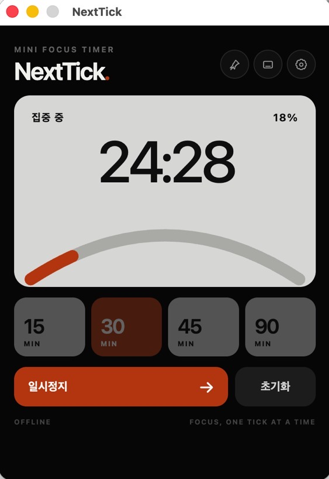
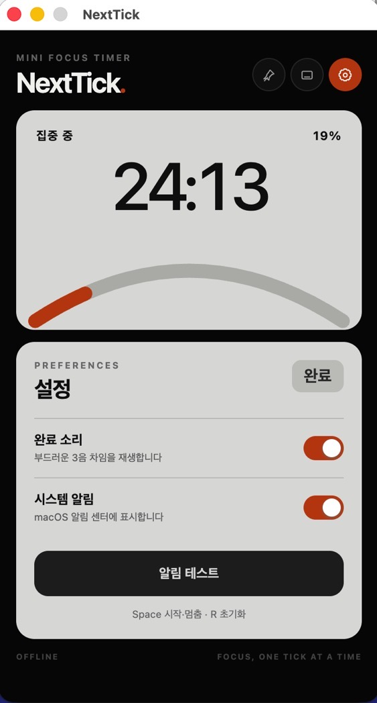

<p align="center">
  
  
</p>

# NextTick

NextTick은 macOS 작업 화면 한쪽에 두고 빠르게 사용하는 오프라인 미니 집중 타이머입니다. React·TypeScript·Vite 기반 UI와 Electron 메인 프로세스의 타이머 엔진을 결합해, 창을 숨기거나 최소화해도 정확한 종료 시각을 유지합니다.

## 주요 기능

- 15·30·45·90분 프리셋과 분·초 직접 입력
- 시작, 일시정지, 재개, 초기화 및 완료 후 다시 시작
- 종료 시각 기준 계산과 macOS 잠자기 복귀 보정
- 기본 모드와 300×190px 미니 모드
- 다른 앱 위에 유지하는 항상 위 핀
- Web Audio 완료 차임과 macOS 시스템 알림
- 오렌지·블루·그린·옐로우 포인트 컬러 선택
- 마지막 시간, 포인트 컬러, 핀, 소리, 알림 설정의 로컬 저장
- 앱 포커스 중 `Space` 시작·멈춤, `R` 초기화
- 단일 앱 인스턴스와 실행 중 종료 확인

## 디자인 변경

- 레퍼런스 이미지의 블랙 바디, 밝은 회색 라운드 패널, 굵은 숫자 타이포그래피 적용
- 선택한 포인트 컬러를 진행 표시, 버튼, 토글, 완료 화면과 미니 모드에 일관되게 반영
- 옐로우처럼 밝은 테마에서는 전경색을 자동 조정해 가독성 유지
- macOS 신호등 버튼은 유지하면서 기본 회색 타이틀바 제거
- 상단 타이틀 영역을 앱 바디와 동일한 블랙 컬러로 연결하고 커스텀 `NextTick` 제목 표시
- 설정 화면에 접근 가능한 컬러 스와치와 상태 표시 제공

## 오류 수정 및 안정화

- 메인과 preload 진입 파일명이 충돌해 패키징 시 `main.js`를 찾지 못하던 문제 수정
- 종료 또는 강제 재실행 직후 파괴된 `BrowserWindow`를 참조하던 예외를 감지하고 창을 안전하게 재생성
- 설정 화면 높이와 스크롤 위치를 조정해 패널 일부가 잘리거나 이전 스크롤 위치가 남던 문제 수정
- `revision` 비교로 늦게 도착한 IPC 응답이 최신 타이머 화면을 덮어쓰지 않도록 처리
- `runId`별 완료 상태를 기록해 tick·절전 복귀 이벤트가 겹쳐도 완료 알림을 한 번만 전송
- 설정 JSON의 손상·누락·잘못된 컬러 값을 기본값으로 복구
- 렌더러 입력과 메인 IPC 인자를 모두 검증하고 허용된 설정 필드만 갱신

## 기술 구성

| 영역 | 구성 |
| --- | --- |
| UI | React 19, TypeScript, 로컬 CSS |
| 번들링 | Vite 7 |
| 데스크톱 | Electron 38, Electron Forge 7 |
| 저장 | Electron `userData/settings.json` |
| 검증 | TypeScript, Vitest |

타이머 상태의 단일 원본은 메인 프로세스의 `TimerService`입니다. 렌더러는 스냅샷만 표시하며 실제 남은 시간은 `targetEndAt - Date.now()`로 계산합니다. 설정은 임시 파일에 먼저 기록한 뒤 rename하는 방식으로 안전하게 교체합니다.

## 요구 환경

- macOS, Apple Silicon 우선
- Node.js 24 (`.nvmrc`)
- npm 11

Electron 38의 macOS 지원 범위 안에서 사용합니다. 공개 배포용 Developer ID 서명과 공증은 이 MVP에 포함하지 않습니다.

## 설치 및 개발 실행

```bash
npm install
npm start
```

## 검사 및 패키징

```bash
npm run typecheck
npm test
npm run package -- --platform=darwin --arch=arm64
```

Apple Silicon 앱은 다음 경로에 생성됩니다.

```text
out/NextTick-darwin-arm64/NextTick.app
```

터미널에서 패키징된 앱을 열려면 다음 명령을 사용합니다.

```bash
open "out/NextTick-darwin-arm64/NextTick.app"
```

Intel Mac용은 `--arch=x64`를 사용하며 실제 Intel 기기 검증이 별도로 필요합니다. ZIP 배포 산출물은 `npm run make`로 생성할 수 있습니다.

## 사용법

- 프리셋을 선택하고 **집중 시작**을 누릅니다.
- 큰 시간 표시를 누르면 분·초를 직접 입력할 수 있습니다.
- 상단 핀은 항상 위, 창 모양 아이콘은 미니 모드, 톱니바퀴는 컬러와 알림 설정입니다.
- 빨간 닫기 버튼은 창만 숨깁니다. Dock 아이콘이나 앱 메뉴의 **NextTick 보기**로 다시 표시합니다.
- `Cmd+Q` 또는 앱 메뉴의 **종료**는 앱을 완전히 종료합니다.

## 검증 상태

- TypeScript 전체 검사 통과
- TimerService 및 설정 정규화 자동 테스트 10개 통과
- Apple Silicon `.app` 패키징 및 실행 확인
- 기본·미니·설정·직접 입력 화면 확인
- 프리셋, 시작·일시정지·초기화, 컬러 저장 확인

다음 항목은 macOS 환경과 권한 상태에 따라 수동 확인이 필요합니다.

- 창 숨김·최소화 중 완료 알림
- 잠자기 복귀 직후 종료 보정
- 다른 일반 앱 위에서 항상 위 동작
- macOS 알림 권한·집중 모드별 동작
- 개발 서버와 네트워크 없이 패키징 앱 실행

완료 차임은 Web Audio로 앱 내부에서 생성하므로 외부 음원이나 네트워크가 필요하지 않습니다.
